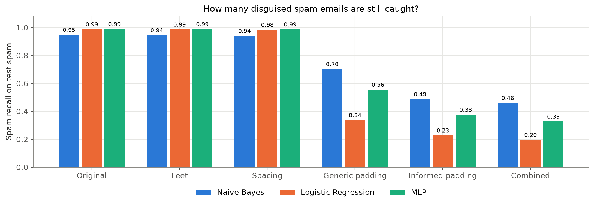
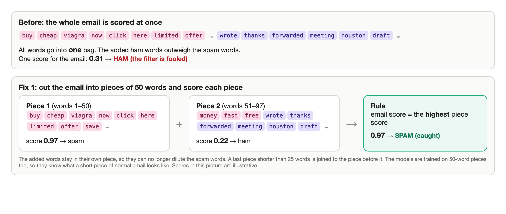

# SpamShield: email spam detection and disguised spam

My final project for the Applied Machine Learning course at Astana IT University (group BDA-2404).
I built the whole project: data loading and cleaning, the three models, the attack script, the fixes and the
analysis.

I trained three spam filters on 122,850 public emails, then tried to fool them with disguised spam:
letters swapped for digits, spaced-out spam words and normal words added to the end of the email.
Adding words broke all three models, so I tested two ways to fix it.

## Data

Three public corpora: TREC 2005 (NIST), CEAS 2008 and Enron-Spam, 165,059 emails in total. After removing
empty and very short emails, emails with conflicting labels and duplicates, 122,850 unique emails were left
(50.1% spam). Split 70 / 15 / 15, stratified: 85,995 train, 18,427 validation, 18,428 test.

The data is not in the repo. The notebook downloads it from the original sources (about 550 MB).

## Models

All three models use the same TF-IDF features (50,000 words and word pairs). Settings were chosen by F1 on the
validation set.

- Multinomial Naive Bayes, alpha = 0.001
- Logistic Regression, C = 10
- MLP (one hidden layer of 64 neurons), best epoch 4

## Results on the test set

| model | F1 | precision | recall | ROC-AUC | ham flagged as spam | train time |
|---|---|---|---|---|---|---|
| Naive Bayes | 0.967 | 0.987 | 0.947 | 0.997 | 1.25% | 0.06 s |
| Logistic Regression | 0.985 | 0.982 | 0.987 | 0.999 | 1.86% | 1.2 s |
| MLP | 0.987 | 0.985 | 0.989 | 0.999 | 1.53% | 46 s |
| always "spam" | 0.668 | 0.501 | 1.000 | 0.5 | 100% | |

The MLP is the most accurate, but Logistic Regression is almost as good and trains about 40 times faster.

## Disguised spam

`disguise_spam.py` changes only the spam emails of the test set:

- leet: spam words get digits instead of letters (`free` -> `fr3e`)
- spacing: spam words get spaces between letters (`cash` -> `c a s h`)
- generic padding: 30 everyday office words are added to the end
- informed padding: 30 of the most "ham-like" words from the training data are added
- combined: leet or spacing plus informed padding



Changing letters barely matters. Adding normal words fools every model, and the most accurate ones are fooled
the most: Logistic Regression catches only 19.5% of spam under the combined attack (98.7% before).

Retraining with disguised spam fixes the attack only for the words it was trained on. With new padding words
the recall stays low (Logistic Regression 0.33 on generic padding).

## Fix: score the email in 50-word pieces



The email is cut into pieces of 50 words, every piece gets its own spam score and the email gets the highest
one. Added normal words end up in their own piece and can no longer dilute the spam words. The models are
retrained on 50-word pieces, and the threshold is chosen on validation so that the same share of normal email
is flagged as before.

| model | recall, combined attack: before | after | recall on normal spam: before | after |
|---|---|---|---|---|
| Naive Bayes | 0.461 | 0.603 | 0.947 | 0.768 |
| Logistic Regression | 0.194 | 0.636 | 0.987 | 0.895 |
| MLP | 0.330 | 0.622 | 0.989 | 0.869 |

The pieces raise recall under attack to 0.60-0.64 at the same false-alarm rate, but miss more normal spam.
The second fix I tried, training with randomly padded spam, gave no protection against new words.

## Files

- `SpamShield_Final_Project.ipynb` - all code with outputs: data, cleaning, features, training, test results,
  attacks, fixes
- `disguise_spam.py` - the disguised spam generator, also works from the command line
- `results/` - all result tables (CSV, JSON)
- `figures/` - all charts
- `docs/research_paper.pdf` - the paper with the full discussion
- `docs/presentation.pdf` - slides

The notebook with plots is easier to read in nbviewer:
[SpamShield_Final_Project.ipynb](https://nbviewer.org/github/Alikonchik-Kaedahara/spamshield/blob/main/SpamShield_Final_Project.ipynb)

## How to run

```bash
python3 -m venv venv
source venv/bin/activate
pip install -r requirements.txt
jupyter nbconvert --to notebook --execute --inplace SpamShield_Final_Project.ipynb
```

The full run takes about 25 minutes on a laptop CPU, the first run also downloads the data.

The attack script on its own:

```bash
python disguise_spam.py test.csv disguised.csv
```

## Credits

The course graded the project as a group assignment, so the paper and the slides also list Alua Sarsenova
and Arailym Orynbay.
